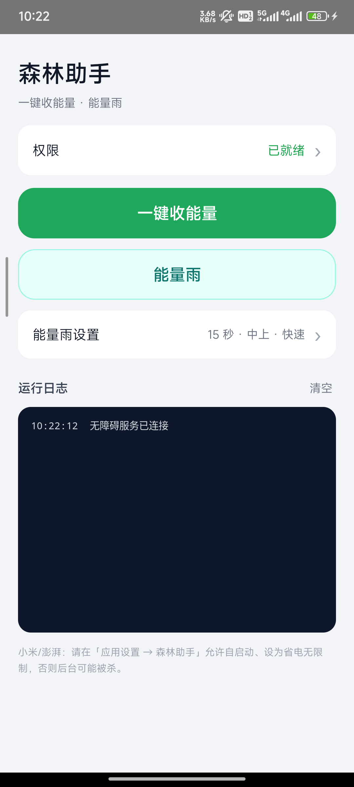
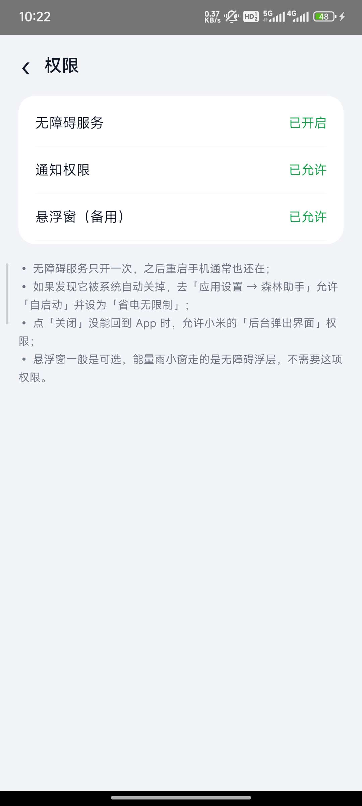
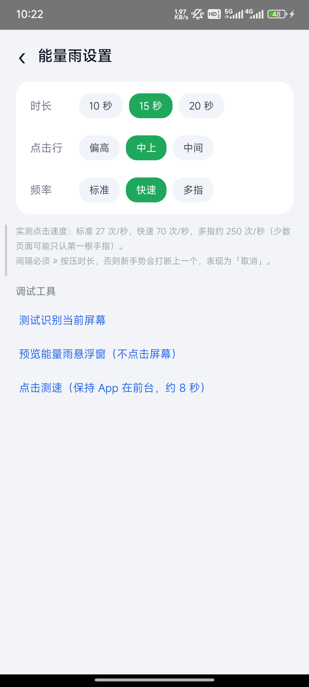
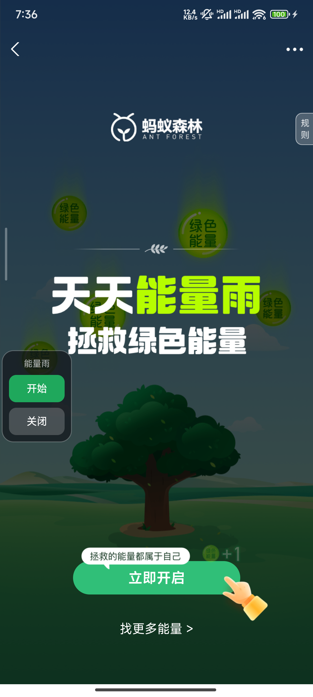

# 森林助手 · Ant Forest Helper

> 基于 Android 无障碍服务的蚂蚁森林自动化工具：一键收能量、能量雨自动连点。

Android 11+ · 无需 Root · 无网络权限 · 零第三方依赖

> ⚠️ 本项目仅供学习 Android 无障碍服务与图像识别使用。自动化操作第三方 App 可能违反其用户协议，请自行评估风险，详见文末[免责声明](#免责声明)。

---

## 功能

### 一键收能量

点一下按钮，自动完成：

1. 打开支付宝 → 蚂蚁森林
2. 识别「找能量」并进入好友森林
3. 识别「一键收」并收取（同一页收两次，尽量收干净）
4. 上划切换下一位好友，循环
5. 连续 3 页都没有可收能量 → 判定收完，退出蚂蚁森林

「一键收」按钮有两种状态，程序能区分：**亮黄色 = 可收**，**淡橙色 = 已收完**（不点，直接上划）。

### 能量雨

进入能量雨页面后，屏幕左侧弹出一个半透明悬浮小窗：

| 状态 | 按钮 |
|---|---|
| 空闲 | 开始 · 打开能量雨 · 关闭 |
| 运行中 | 暂停（+ 倒计时） |

- **开始**：若还在落地页会先点「立即开启」，然后在屏幕中上部那一行横向多点高频连点，倒计时结束自动停
- **暂停**：立刻停手，恢复空闲态
- **打开能量雨**：误关页面或跳去了支付宝首页时，一键重新拉起并回到能量雨页
- **关闭**：退出支付宝并回到本 App

过程中如果弹出支付宝安全验证（滑块），程序会**自动停止**并提示手动验证，不会尝试绕过。

---

## 截图

| 首页 | 权限 | 能量雨设置 |
|---|---|---|
|  |  |  |

能量雨悬浮窗：



---

## 工作原理

### 为什么需要截图识别

蚂蚁森林的主场景是 **Canvas 绘制**的：能量球、「一键收」「找能量」这些按钮在 Android 无障碍树里只有 `[0,0][0,0]` 的空节点——按文本查找控件的方案拿不到它们。

所以「一键收」走的是图像识别：

1. `AccessibilityService.takeScreenshot()` 截图
2. 转灰度、缩小一半
3. 在右下角固定 ROI 内做**归一化互相关（NCC）模板匹配**
4. `dispatchGesture()` 注入点击 / 上划

模板放在 `app/src/main/assets/`，按 1080 宽为基准，运行时按屏幕宽度等比缩放。

### 能量雨为什么用节点点击

能量雨的「能量雨」「立即开启」是原生控件，无障碍树里有文本节点，直接找节点 + `ACTION_CLICK` 比重截图快且稳。

> 注意：支付宝页面上 `findAccessibilityNodeInfosByText()` 有时返回空，本项目改为自己 DFS 遍历节点树匹配文本，实测更可靠。

### 点击频率的坑

`dispatchGesture()` 的规则是：**新手势会取消正在进行的旧手势**。所以「间隔」必须大于等于「按压时长」，否则点击会互相打断（表现为大量 `onCancelled`，实际一次都没点出去）。

实测参考值（不同设备有差异）：

| 档位 | 按压 / 间隔 | 实际速度 | 备注 |
|---|---|---|---|
| 标准 | 30 / 35 ms | 约 27 次/秒 | 最稳 |
| 快速 | 10 / 12 ms | 约 70 次/秒 | 推荐 |
| 多指 | 9 点同时按，25 / 30 ms | 约 250 次/秒 | 部分页面可能只认第一根手指 |

---

## 环境要求

| 项目 | 要求 |
|---|---|
| 系统 | Android 11（API 30）及以上 |
| 支付宝 | 已安装并登录 |
| Root | 不需要 |
| 网络权限 | 不需要（App 本身不联网） |

---

## 安装

### 方式一：下载 APK

仓库的 [`apk/`](apk/) 目录里已带好打包产物 `森林助手-1.0.0.apk`，直接下载安装即可（需允许「安装未知来源应用」）。也可以到 **Releases** 页面下载。

### 方式二：自行编译

见下方[编译](#编译)。

---

## 使用

### 1. 开启权限

首次打开 App，点首页的「权限」进入权限页，按提示开启：

- **无障碍服务**（必开）
- **通知权限**（建议开，用于显示进度）

### 2. 一键收能量

回到首页点「一键收能量」，手机会自动跳到支付宝开始收取。**运行期间请不要锁屏**（锁屏后无法截图）。

### 3. 能量雨

点「能量雨」，等悬浮窗出现后点「开始」。拿到第二次机会（赠送好友 / 完成任务）后，再点一次「开始」即可。

---

## 参数

「能量雨设置」页里可以调，改完自动保存：

| 项目 | 选项 | 默认 |
|---|---|---|
| 时长 | 10 / 15 / 20 秒 | 15 秒 |
| 点击行 | 偏高 24% / 中上 28% / 中间 34% | 中上 |
| 频率 | 标准 / 快速 / 多指 | 快速 |

设置页还有三个调试工具：测试当前屏幕识别分数、预览悬浮窗、点击测速。

---

## 权限说明

| 权限 | 用途 | 是否必须 |
|---|---|---|
| 无障碍服务 | 截图、点击、按键 | 必须 |
| 通知 | 显示收取进度、停止按钮 | 建议 |
| 悬浮窗 | 仅在无障碍浮层不可用时兜底 | 可选 |

App 不上传任何数据，也不包含网络权限。

---

## 常见问题

**Q：无障碍服务需要每次打开 App 都重新授权吗？**

不需要。开启一次后会写入系统设置，重启手机通常也还在。只有在手动关闭、覆盖安装/卸载重装、或部分国产 ROM 重启后自动关闭时才需要重开。如果被系统关掉，可以去应用设置里允许「自启动」、把省电策略设为「无限制」。

**Q：点了「开始」没反应？**

先在设置页点「测试识别当前屏幕」，看日志里的匹配分数：高于 0.65 说明识别正常，明显偏低说明画面和模板对不上（分辨率差异过大，或支付宝改版）。

**Q：提示触发风控怎么办？**

手动完成支付宝的滑块验证，验证通过、游戏开始后再点悬浮窗的「开始」。程序不会尝试破解验证码。

**Q：点「关闭」后没回到 App？**

部分 ROM 会拦截后台启动 Activity。可以在系统设置里允许本 App「后台弹出界面 / 显示在其他应用上层」。

**Q：为什么不能锁屏运行？**

无障碍截图在锁屏状态下不可用，这是系统限制。

---

## 已知限制

- 一键收只识别「一键收」按钮；个别页面（如提示卡片）没有该按钮会被跳过
- 能量雨是「固定一行 + 横向多点轮询」，不是逐球追踪，球下落极快时仍可能漏点
- 模板按固定 UI 制作，支付宝大改版后需要重新截图更新 `assets/` 里的模板
- 触发安全验证后会停止，需要人工介入

---

## 项目结构

```
app/src/main/java/com/sing1/apply/
├── MainActivity.java                 # 首页
├── PermissionsActivity.java          # 权限页
├── SettingsActivity.java             # 能量雨设置页
├── ForestAccessibilityService.java   # 截图 / 手势 / 节点查找
├── Runner.java                       # 一键收能量状态机
├── Matcher.java                      # 灰度 + NCC 模板匹配
├── RainSession.java                  # 能量雨状态机
├── RainHud.java                      # 半透明悬浮小窗
├── RainConfig.java                   # 能量雨参数
├── Notifier.java                     # 进度通知
├── StopReceiver.java                 # 通知栏「停止」
├── Perm.java                         # 权限状态判断
└── LogBus.java                       # 进程内日志

app/src/main/assets/                  # 识别模板（3 张）
app/src/main/res/xml/                 # 无障碍服务配置
app/apply.keystore                    # 打包用签名文件（开源公开）
apk/森林助手-1.0.0.apk                 # 打包产物
```

---

## 编译

需要 JDK 17 与 Android SDK（compileSdk 35）：

```bash
git clone <this-repo>
cd <repo>

# 指向本地 SDK
echo "sdk.dir=$ANDROID_HOME" > local.properties

./gradlew assembleDebug     # 产物：app/build/outputs/apk/debug/app-debug.apk
./gradlew assembleRelease   # 产物：apk/森林助手-1.0.0.apk
```

> Release 使用仓库自带的 `app/apply.keystore` 签名（开源项目，密钥与密码公开在 `app/build.gradle` 里）。

---

## 免责声明

- 本项目与支付宝、蚂蚁森林无任何关联，非官方工具。
- 自动化操作第三方 App 可能违反其用户协议，存在账号被限制的风险，**使用前请自行评估**。
- 本项目不包含、也不会实现任何绕过人机验证（验证码 / 滑块）的功能。
- 代码按「现状」提供，作者不对使用后果（包括但不限于账号异常、能量损失）承担责任。

---

## License

[MIT](LICENSE)
